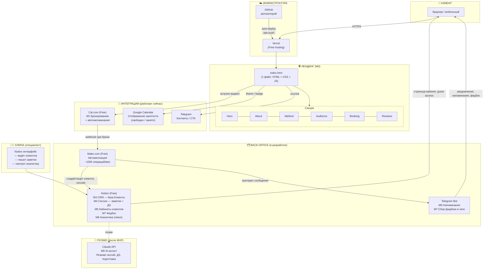

# Архитектура: Личное веб-приложение Алины Шведовой
### Практика «Вселенская терапия»

> Последнее обновление: июнь 2026

---

## Обзор системы

Одностраничный лендинг + back-office на бесплатных сервисах. Бюджет $0. Никаких фреймворков и баз данных под управлением — всё собрано из готовых инструментов.

---

## Диаграмма архитектуры



---

## Слои системы

### 1. Публичный лендинг (M0) — готово ✅

| Компонент | Детали |
|---|---|
| Файл | `index.html` — HTML + CSS + JS в одном файле |
| Хостинг | Vercel Free |
| Деплой | GitHub push → Vercel авто-деплой |
| URL | https://alinavselenka.vercel.app |
| Шрифты | Raleway, Montserrat, Josefin Sans (Google Fonts) |
| Логотип | SVG-спираль Фибоначчи, генерируется в коде |

**Секции:** nav → hero → trust-strip → about → method → audience → booking → reviews → footer

### 2. Бронирование (M1) — готово ✅

| Компонент | Детали |
|---|---|
| Сервис | Cal.com Free |
| Виджет | Встроен inline в секцию `.booking` через `#cal-inline` |
| Напоминания | Авто: подтверждение, за 24ч, за 1–2ч |
| Занятость | Google Calendar «свободно/занято» (детали клиентов скрыты) |

### 3. Back-office (M3–M8) — в разработке 🔄

| Модуль | Инструмент | Статус |
|---|---|---|
| M3 CRM | Notion (база Клиенты) | Планируется |
| M4 Сессии + заметки | Notion (база Сессии) | Планируется |
| M5 Кабинет клиента | Notion (страница, guest access) | Планируется |
| M6 Напоминания | Telegram Bot + Make.com | Планируется |
| M7 Фидбэк | Telegram Bot → Notion | Планируется |
| M8 Аналитика | Notion views | Планируется |

### 4. Автоматизация — ключевые потоки Make.com

```
Cal.com: новая бронь
  └─→ Make.com
       ├─→ Notion: найти/создать клиента в базе Клиенты
       ├─→ Notion: создать сессию в базе Сессии
       └─→ Telegram Bot: отправить подтверждение клиенту + уведомление Алине

Notion: статус сессии → «Проведена»
  └─→ Make.com
       └─→ Telegram Bot: запросить фидбэк у клиента → сохранить оценку и комментарий в Notion
```

---

## Ограничения бесплатных планов

| Сервис | Лимит |
|---|---|
| Notion Free | до 10 гостей на воркспейс |
| Make.com Free | ~1 000 операций/месяц |
| Telegram Bot | без лимитов |
| Vercel Free | без ограничений для статики |
| Cal.com Free | без ограничений слотов |

---

## Принципы архитектуры

- **Single-file frontend** — весь лендинг в `index.html`, никаких сборщиков
- **No-code back-office** — только готовые SaaS, без кода и баз данных
- **$0 бюджет** — все инструменты на бесплатных планах
- **Make.com как шина** — вся автоматизация проходит через Make
- **Notion как кабинет** — никакой авторизации, доступ по guest access
